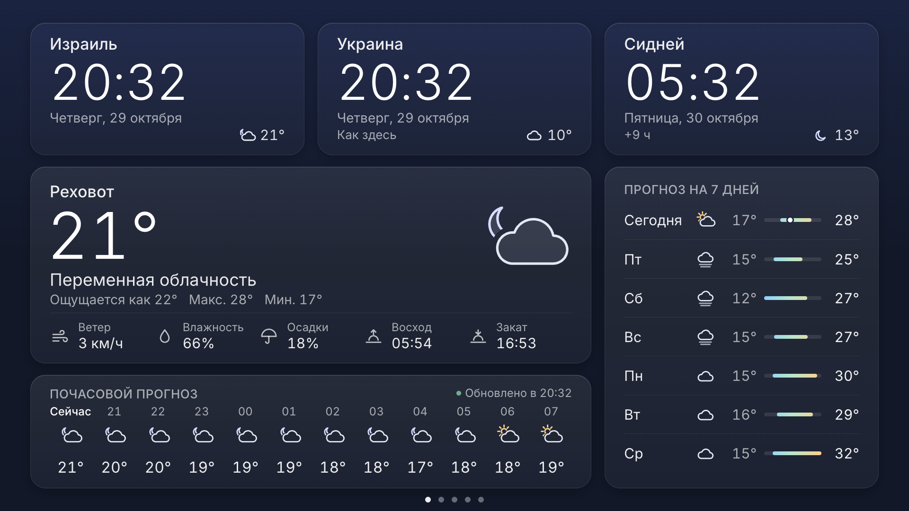
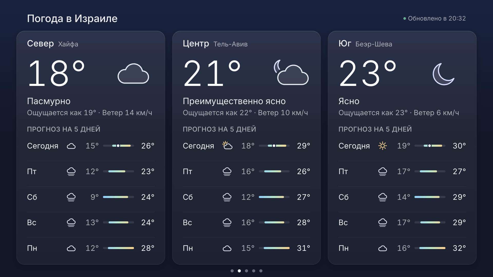
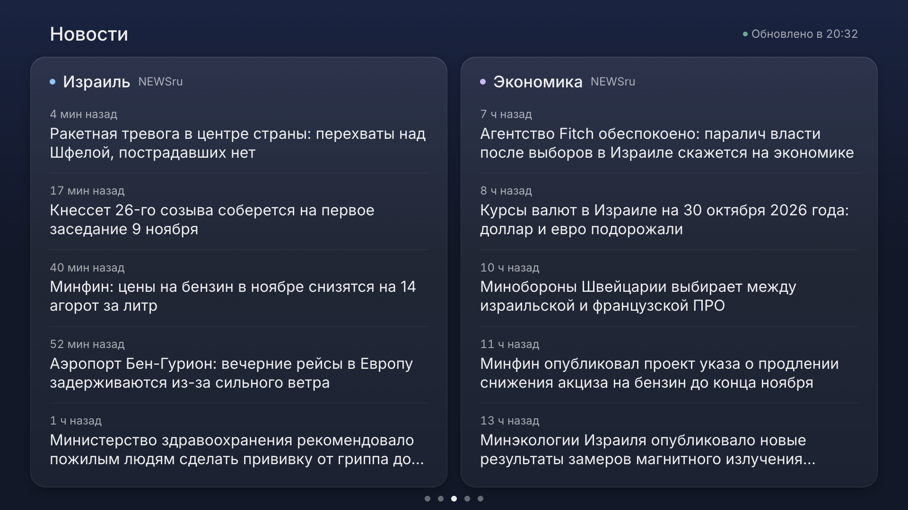
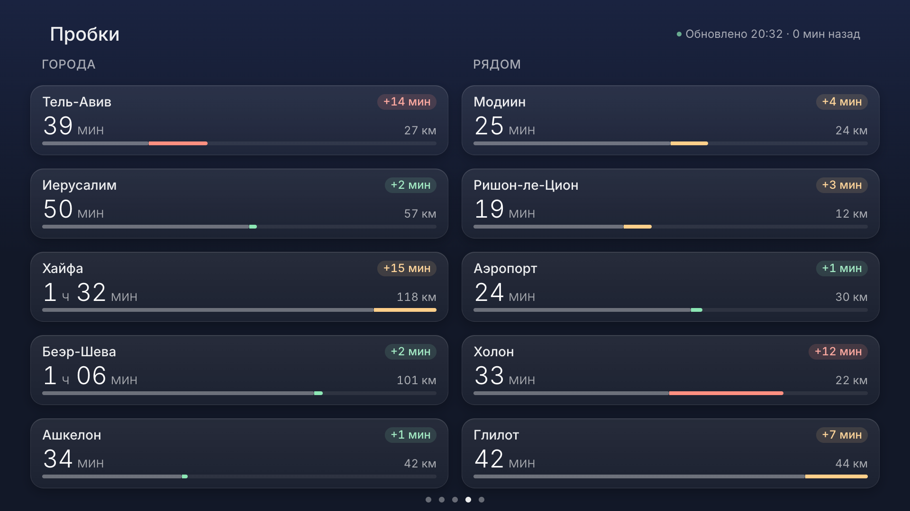

<p align="center">
  
</p>

<h1 align="center">Home Dashboard</h1>

<p align="center">
  <b>Your family's morning glance, on the TV you already own.</b><br>
  A calm, always-on dashboard for Samsung Smart TVs — even a 2017 one.<br>
  Clocks for Israel, Ukraine and Sydney · weather at home and across Israel · Israeli news · traffic and a live traffic map · Home Front Command alerts.
</p>

<p align="center">
  
  
  <br>
  
  
  <br>
  
  
</p>

<p align="center">
  
</p>

## See it in action

<table>
  <tr>
    <td></td>
    <td></td>
  </tr>
  <tr><td align="center"><b>Weather in Israel</b> — North, Centre, South, five days ahead</td><td align="center"><b>News</b> — Ynet and Globes in Hebrew, right to left</td></tr>
  <tr>
    <td colspan="2"></td>
  </tr>
  <tr><td colspan="2" align="center"><b>Traffic</b> — ten routes from home, refreshed the moment you open the screen</td></tr>
</table>

<sub>Screenshots are rendered at 1920×1080 in desktop Chrome from the test fixtures (the headlines and traffic numbers are sample data). A screenshot of the live TomTom traffic map is still to come.</sub>

It is a real installed **Tizen web app** (a signed `.wgt` package), not a web page: the TV's browser is
slow and limited, while an installed app starts instantly, keeps the screen on and exits with Back.
It runs on Samsung Tizen TVs from 2017 on (Tizen 3.0 or newer; 2016 models run Tizen 2.x and refuse the
package). The oldest target is a 2017 UE50MU7000 (Tizen 3.0, Chromium 47), so the code is plain ES5 with
no framework, no bundler and no backend. The typeface, [Inter](https://rsms.me/inter/), ships inside the
app (static Light / Regular / Medium, Latin + Cyrillic, about 96 KB), so the TV shows the same type as the
screenshot instead of whatever system font it has.

## What it shows

Five screens, switched with the remote's ◀ ▶ and shown in turn every 45 seconds (page dots at the bottom
mark the current one). Any key pauses the rotation for two minutes; `rotation.enabled: false` in the config
turns it off. A screen that is not on view keeps its content and costs nothing: it is redrawn when it comes in.
A screen opened with ◀ ▶ refreshes its data at once (the owner's rule, 2026-10-30): the weather for the home and Israel
screens, both news feeds, the traffic batch (within its daily cap), a new traffic-map overlay. A request already running is
never started twice, and a rotation arrival keeps each screen's own schedule.

**1 · Home**

- **World clocks**: Israel (Asia/Jerusalem), Ukraine (Europe/Kyiv) and Sydney (Australia/Sydney), in 24-hour
  time with the weekday, the date, the difference to Israel and each city's current temperature. A card is
  tinted for the night from that city's sunrise and sunset.
- **Weather** for Rehovot from [Open-Meteo](https://open-meteo.com/) (free, no API key): temperature, feels-like,
  condition, wind, humidity, today's high/low, chance of rain, sunrise/sunset, a 12-hour strip and a 7-day list.
- **Status**: "Updated at HH:MM". When a refresh fails, the last good data stays on screen and is marked as
  not updating, with the time it is from; every temperature from that data (the main card and each clock
  card) is dimmed, and the amber status line says it once. With no data at all, the weather card says so once, with
  the time of the next attempt, and the forecast rows stay in place as quiet placeholders.

### Behaviour worth knowing

- **The time is never silently wrong.** The TV's own time-zone setting is not trusted: each clock takes UTC
  from the device and converts it with the zone's rules. Old TVs ship a 2015 time-zone database that does
  not know "Europe/Kyiv", so the app falls back to "Europe/Kiev". If the TV has no usable time-zone support
  at all, built-in daylight-saving rules for Israel, the EU and Sydney are used and the clock shows a small
  "≈". When the TV's time-zone data and the built-in rule disagree, the rule wins (it is tested against the
  real time-zone database for every hour of 2025–2030) and the disagreement is logged. If neither works,
  the clock says "Zone unknown" instead of a time.
- **Weather refresh**: every 15 minutes, ONE request for all places (Open-Meteo takes comma-separated
  coordinates), about 1.5 KB compressed. After a failure it waits a random time between 30 seconds and
  1, 2, 4 and 8 minutes, then up to 15 minutes, so it never loops tightly and never synchronises. Data
  older than 45 minutes is marked stale even if no request failed. "Now" and "Today" follow the clock, not
  the age of the data.
- **Burn-in care**: the whole layout drifts by a few pixels every 3 minutes, slowly (6 s), so static text
  never sits on the same pixels for hours. The layout is its own GPU layer, so a drift repaints nothing.
- **Screen saver**: switched off while the app runs (the result is logged); **Back** closes the app.
  The TV's own **Eco "Auto Power Off"** is separate and an app cannot override it: it switches the TV off
  after about 4 hours without a remote key press. For an always-on dashboard turn it off in
  *Settings → General → Eco Solution → Auto Power Off*. Not yet verified on the TV for a run longer than 4 hours.
- **Languages**: Russian (default) and English. Hebrew and Ukrainian slots are ready in `js/i18n.js`.

**2 · Weather in Israel**: three cards side by side — North (Haifa), Centre (Tel Aviv), South (Beer Sheva) — each
with the temperature now, its condition, feels-like and wind, and a 5-day list with the same range bars as the
main card. The regions ride the main weather's single Open-Meteo request (six places, one request), so this screen
costs no request of its own; a failed refresh dims every card and the header says it once.

**3 · News**: two columns of Israeli news in Hebrew, read right to left, five headlines each, newest first, with how
long ago: «Израиль» from [Ynet](https://www.ynet.co.il/Integration/StoryRss2.xml) (its main news feed) and
«Экономика» from [Globes](https://www.globes.co.il/) (its home-page feed). Calcalist's feeds answer 403 and
TheMarker's stopped in May 2026 (checked 2026-10-30). Both feeds come in one parallel round every 10 minutes (two
requests); a story a feed repeats is shown once, and feed text is reduced to plain text (no feed HTML ever reaches
the screen). A headline takes at most two lines (a fixed two-line box; a longer one ends with an ellipsis), and row n of both columns
sits on one line. Both columns are always there: while a feed loads, or when it has nothing yet, its own column says so
(«Загружаем новости…», «Нет данных»). A feed that fails keeps its last stories and says "not updating" in its own column
only, while the header stays "Updated at"; when nothing came at all the header says «Новости временно недоступны · повторим
в HH:MM». Hebrew is drawn in a bundled Noto Sans Hebrew (Regular, the Hebrew block only, about 7 KB, OFL) so the TV does not
depend on its system fonts for it.

**4 · Traffic**: ten widgets in two columns of five. «Города»: from Rehovot to the centres of Tel Aviv, Jerusalem, Haifa,
Beer Sheva and Ashkelon; «Рядом»: to Modi'in, Rishon LeZion, Ben Gurion Airport (Terminal 3), Holon and Glilot (Cinema
City). The main roads are not here: they are watched on the traffic map (screen 5). Each widget: the name and a soft
green / amber / red chip with the delay, the time now and the length, and a time bar (bars compare within a column). It
comes from the [TomTom Routing API](https://developer.tomtom.com/routing-api) in ONE batch request (10 items, summaries
only). TomTom's free routing tier is 20,000 items a **month**, shared by every key on the account
(docs.tomtom.com/pricing, read 2026-10-30), so one rule decides when a batch is sent (`Config.traffic.schedule`; one
function, `Traffic.decide`, for every path), at any hour of the day:

- only while the traffic screen is on view and the TV shows it (a hidden screen costs nothing, nothing is sent at boot),
  and one batch at a time (20-second deadline);
- opened with ◀ ▶: at once, every time, however old the data is;
- arrived with the rotation, staying open, or the TV waking: at most once every 25 minutes since the last attempt
  (`minIntervalMs`), failures and refusals included (no separate retry path, no catch-up);
- never past 580 items (58 batches) on a UTC date (`dailyItemCap`): before every request the app writes
  `{utcDate, used + 10, lastAttemptAt}` to the TV's localStorage (`tt-quota`), reads it back, and sends only if it was
  stored; nothing is refunded (a failure, a timeout, a refusal, a restart). Any 31 days (with arbitrary alignment they
  touch 32 UTC dates) stay ≤ 32 × 580 = 18,560 items; parked on the screen at the healthy cadence it is 58 batches a UTC
  date, 17,860 in 31 days (`tests/build-config.test.js` simulates these, restarts and the 25-hour DST date included).
- A deadline TomTom gives (`Retry-After` on a 403, 429 or 503, in seconds or as a date) is written into the same record
  (`retryNotBefore`, read back) and holds for every path, ◀ ▶ opens and restarts included; the refusal line shows the
  later of "last attempt + 25 min" and that deadline («автоматический повтор не раньше HH:MM»).
- A clock that went back is corrected without sending: a last attempt in the future becomes "now" (the next batch 25
  minutes later), a counter date in the future becomes today's UTC date with its count kept. If localStorage fails or the
  counter is corrupt, nothing is sent and the screen says «Обновления пробок приостановлены: не удалось проверить или
  сохранить счётчик запросов».

The rows and their times are kept in localStorage (`tt-cache`) and shown at once after a restart. The header says when the
data on screen is from, always the OLDEST row: «Обновлено 20:32 · 3 мин назад», while a batch runs «Обновляется… · данные
от 20:32», after 30 minutes or a failed update «Данные устарели · обновлено 20:32 · 41 мин назад» (a date «29.10» before
the time when it is not today), and data timed in the future «Данные устарели · время данных требует проверки» (never a
negative age). Why it cannot update is a second line under it, never in its place: «Дневной лимит запросов пробок исчерпан
· обновление после 30.10 02:00», «TomTom отклонил запрос (доступ или лимит) · повтор не раньше 20:57» (401/403/429), or the
storage pause. With nothing to show, the card says «Обновляется…», «Не удалось обновить пробки» or the same message. A
place TomTom cannot route says «Нет данных» in its own widget and never marks the screen as not current. It needs a
TomTom key (see Build); without one the screen says how to connect it and sends nothing. The routes were checked once
against the live API (2026-10-30); the tests run on TomTom's documented answers.

**5 · Traffic map**: a live traffic map centred on Rehovot (a white dot), Tel Aviv to Ashdod in view, with the main roads:
TomTom's night base map with the traffic-flow overlay (style `relative0-dark`, with a legend in its colours), plain image
tiles of 512 px at zoom 10 (4 × 3 tiles per layer), with the same TomTom key. Tiles load only while the map is on view
(rotation visits included): the base map until it has loaded once (retried every 5 minutes while on view), the overlay on
arrival when it is due (at once when opened with ◀ ▶) and every 5 minutes while on view. Every tile has a 20-second deadline: a tile that never answers
fails its round instead of stopping the map, and leaving the screen stops the tiles in flight. A failed overlay keeps the
last one on screen, waits 5 minutes (also across leaving and coming back), and the header says «Карта недоступна · данные от
HH:MM»; until the base map is in, the overlay is not drawn, and while the card says «Загружаем карту…» or «Карта недоступна»
the dot and the legend are hidden. Each overlay round carries a stamp in its tile addresses: TomTom serves the tiles
`no-store`, but a page reuses an image it already shows under the same address without asking the network, so without the
stamp the overlay would never change. TomTom's free tier allows 200,000 map tiles and 200,000 traffic tiles a month (about
6,600 a day each); a day parked on the map costs 3,456 traffic tiles, a day with the rotation 2,304, and a test simulates
both.

**Israel alerts (all screens)**: the [Home Front Command](https://www.oref.org.il/) alert feed is read every
5 seconds (one request at a time, 4-second timeout). When an alert covers Rehovot, a deep-red full-screen
notice appears over everything: the kind of alert, the area, the time it started and the instruction. It
never ends on a guess: it stays for the instruction's minutes after the area was last listed (10 minutes when
the instruction names none) and until the feed has answered without the area for a full minute; a failed or
malformed answer never counts as "not listed". An end message ("the event has ended") never clears or shortens
it: end messages are recognised by exact title only so that they never raise one. The remote cannot dismiss it (Back still
closes the app) and the rotation waits. An alert in a nearby town shows a quiet line in the bottom-right
corner (three names at most, "и ещё N" for the rest). If the feed cannot be reached three times in a row, the
corner says "Тревоги: нет связи" — and during an alert the alert itself says so, with the time of the last good
answer; the app never claims "all clear". The feed answers only inside Israel. Areas are configured by their
Hebrew names in `js/config.js` (`alerts.areas`, `alerts.nearby`), spelled as in Pikud HaOref's area list (a
test checks every name against a copy of it in `tests/fixtures/oref/`).

## Configure

Everything lives in [`js/config.js`](js/config.js): language, screens and rotation, clocks (zones and order),
weather places (the first is the main card), news feeds, traffic routes and when they are refreshed
(`traffic.schedule`), the traffic map, alert areas, refresh intervals and burn-in timing. Names on screen are in `js/i18n.js`.

## Build, sign and install on any Samsung TV

You need a Samsung account, the Tizen CLI, and the TV in Developer Mode. The full walk-through, including
how to get Samsung certificates on a Mac and the `install failed[118]` trap, is in
[docs/DEPLOY.md](docs/DEPLOY.md). Short version:

```sh
cp build.local.env.example build.local.env   # fill in CERT_PROFILE, DEVICE_PROFILE, TV (and TOMTOM_KEY for traffic)
./build.sh --package                         # build + sign only → .buildResult/HomeDashboard.wgt
./build.sh                                   # build + sign + install on the TV + launch
```

`tools/find-tv.sh` finds the TV again when the router gives it a new address. It never guesses: when
several devices answer, it stops unless `TV_DUID` in `build.local.env` names the TV, and then it installs
only on the device that reports that DUID. `./build.sh` refuses any argument other than `--package` and
`--help` before it builds or connects to anything.

`TOMTOM_KEY` (letters and digits, from developer.tomtom.com) is put into the packaged copy of
`js/config.js` only; the repository keeps the `__TOMTOM_KEY__` placeholder and a test pins it. TomTom's free tier
(docs.tomtom.com/pricing, read 2026-10-30) is 20,000 routing items a month and 200,000 map and 200,000 traffic tiles a
month. The traffic screen reserves every routing item before it sends it and stops at 580 items a UTC date
(`Config.traffic.schedule.dailyItemCap`), so any 31 days stay ≤ 18,560 — see screen 4. A refused key (401/403) is
also what TomTom answers when the account's own monthly limit is used up.

**Owner note (TomTom account).** The routing allowance is shared by every key on the account: another key or app on the
same account spends the same 20,000 items. Do not add prepaid credit or top-ups to the account. The terms behind the
account's "Evaluation" label have not been verified.

## Develop and test

Open `index.html` in desktop Chrome at 1920×1080 for development. Tests use Node 22's built-in runner and
have no dependencies in this repo:

```sh
tests/run.sh                         # unit tests: time zones, weather, news, traffic, traffic map, alerts, screens, refresh/stale/back-off, i18n, packaging, build.sh / find-tv.sh
PUPPETEER_CORE_DIR=<dir with puppeteer-core> tests/run.sh --browser   # + every screen and the alert in headless Chrome at 1920×1080
ACORN=<path to acorn> tools/es5-gate.sh                               # every script must parse as ES5
PUPPETEER_CORE_DIR=... node tools/screenshot.mjs                      # regenerate docs/screenshot.png
PUPPETEER_CORE_DIR=... node tools/make-icon.mjs                       # img/icon.svg → img/icon.png (512×423)
```

The browser tests answer Open-Meteo, the news feeds, the alert feed and TomTom from `tests/fixtures/` (the
recorded shape of each source; the news stories in them are invented) and fail (never skip) without
puppeteer-core.

## Roadmap

- Air-raid alerts in Ukraine (needs a token)
- Currency: Bank of Israel and National Bank of Ukraine rates
- Shabbat times and holidays (Hebcal)
- Family birthdays and reminders
- Photo frame mode
- Night mode (dimmer, warmer, clocks only)

## License

MIT © Yaroslav Rudenko. See [LICENSE](LICENSE). The same licence covers the sibling project [Настин кинозал](https://github.com/yaroslavrudenko/nastin-kinozal), an IPTV player for the same TVs.
The bundled Inter font is © The Inter Project Authors, under the SIL Open Font License 1.1
([fonts/OFL.txt](fonts/OFL.txt)).
