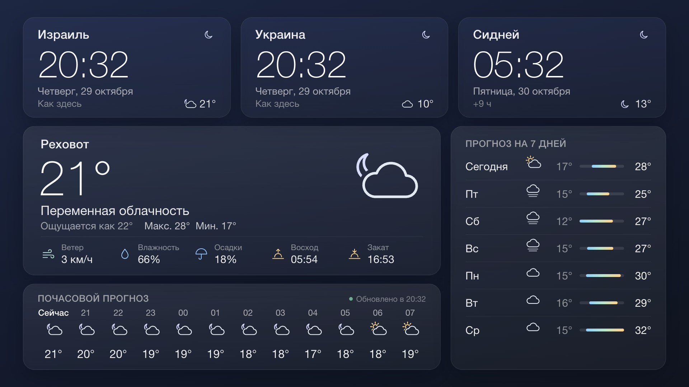

# Home Dashboard for Samsung TV

A calm family dashboard for a Samsung Smart TV: the time in Israel, Ukraine and Sydney, and the weather
at home, in one glance from the sofa. Switch the TV on, open the app, and leave it running.



It is a real installed **Tizen web app** (a signed `.wgt` package), not a web page: the TV's browser is
slow and limited, while an installed app starts instantly, keeps the screen on and exits with Back.
It runs on every Samsung Tizen TV from 2016 on. The oldest target is a 2017 UE50MU7000 (Tizen 3.0,
Chromium 47), so the code is plain ES5 with no framework, no bundler and no backend.

## What it shows

- **World clocks**: Israel (Asia/Jerusalem), Ukraine (Europe/Kyiv) and Sydney (Australia/Sydney), in 24-hour
  time with the weekday, the date, a day/night hint, the difference to Israel and each city's current temperature.
- **Weather** for Rehovot from [Open-Meteo](https://open-meteo.com/) (free, no API key): temperature, feels-like,
  condition, wind, humidity, today's high/low, chance of rain, sunrise/sunset, a 12-hour strip and a 7-day list.
- **Status**: "Updated at HH:MM". When a refresh fails, the last good data stays on screen and is marked as
  not updating, with the time it is from.

### Behaviour worth knowing

- **The time is never silently wrong.** The TV's own time-zone setting is not trusted: each clock takes UTC
  from the device and converts it with the zone's rules. Old TVs ship a 2015 time-zone database that does
  not know "Europe/Kyiv", so the app falls back to "Europe/Kiev". If the TV has no usable time-zone support
  at all, built-in daylight-saving rules for Israel, the EU and Sydney are used and the clock shows "≈".
  If neither works, the clock shows "--:--".
- **Weather refresh**: every 15 minutes, all places requested in parallel, one request per place. After a
  failure it retries after 1, 2, 4 and 8 minutes, then returns to every 15 minutes. It never loops tightly.
  Data older than 45 minutes is marked stale even if no request failed.
- **Burn-in care**: the whole layout drifts by a few pixels every 3 minutes, slowly (6 s), so static text
  never sits on the same pixels for hours.
- **Screen stays on** while the app runs; **Back** closes it.
- **Languages**: Russian (default) and English. Hebrew and Ukrainian slots are ready in `js/i18n.js`.

## Configure

Everything lives in [`js/config.js`](js/config.js): language, clocks (zones and order), weather places
(the first is the main card), refresh intervals and burn-in timing. City names are in `js/i18n.js`.

## Build, sign and install on any Samsung TV

You need a Samsung account, the Tizen CLI, and the TV in Developer Mode. The full walk-through, including
how to get Samsung certificates on a Mac and the `install failed[118]` trap, is in
[docs/DEPLOY.md](docs/DEPLOY.md). Short version:

```sh
cp build.local.env.example build.local.env   # fill in CERT_PROFILE, DEVICE_PROFILE, TV
./build.sh --package                         # build + sign only → .buildResult/HomeDashboard.wgt
./build.sh                                   # build + sign + install on the TV + launch
```

`tools/find-tv.sh` finds the TV again when the router gives it a new address.

## Develop and test

Open `index.html` in desktop Chrome at 1920×1080 for development. Tests use Node 22's built-in runner and
have no dependencies in this repo:

```sh
tests/run.sh                         # unit tests: time zones, weather parsing, refresh/stale/back-off, i18n, packaging
PUPPETEER_CORE_DIR=<dir with puppeteer-core> tests/run.sh --browser   # + layout smoke in headless Chrome at 1920×1080
ACORN=<path to acorn> tools/es5-gate.sh                               # every script must parse as ES5
PUPPETEER_CORE_DIR=... node tools/screenshot.mjs                      # regenerate docs/screenshot.png
PUPPETEER_CORE_DIR=... node tools/make-icon.mjs                       # img/icon.svg → img/icon.png (512×423)
```

The browser tests answer Open-Meteo from recorded responses in `tests/fixtures/` and fail (never skip)
without puppeteer-core.

## Roadmap

- Alerts: Pikud HaOref (Israel Home Front Command) and air-raid alerts in Ukraine
- Currency: Bank of Israel and National Bank of Ukraine rates
- Shabbat times and holidays (Hebcal)
- News headlines (RSS)
- Traffic in central Israel (TomTom or HERE, needs a key)
- Family birthdays and reminders
- Photo frame mode
- Night mode (dimmer, warmer, clocks only)

## License

MIT © Yaroslav Rudenko. See [LICENSE](LICENSE).
