<p align="center">
  
</p>

<h1 align="center">Home Dashboard</h1>

<p align="center">
  <b>Your family's morning glance, on the TV you already own — the companion to <a href="https://github.com/yaroslavrudenko/nastin-kinozal">«Настин кинозал»</a>.</b><br>
  A calm, always-on dashboard for Samsung Smart TVs — from 2017 models to the newest — that sits on top while the player's music plays on.<br>
  Clocks for Israel, Ukraine and Sydney · weather, air quality and UV at home and across Israel · news · markets · Shabbat and holidays · live traffic times and a live traffic map · Pikud HaOref alerts on every screen.<br>
  In Russian, Hebrew or Ukrainian — ▲ / ▼ on the remote.
</p>

## Three languages, one remote

**Русский · עברית · Українська.** Press ▼ or ▲ on the remote and every screen changes language at once, with no reload. The TV
remembers the choice.

- **Hebrew is right to left, all of it.** The whole layout mirrors; times, prices and temperatures stay left to right.
- **Each language reads its own news:** NEWSru.co.il in Russian, Ynet and Globes in Hebrew, Українська правда and
  Економічна правда in Ukrainian.
- **Our own names, not a feed's.** The holidays and fasts, the Hebrew months, all 59 weekly parashot and the books of the
  Torah and haftarah readings are translated by us for Russian and Ukrainian (Hebcal's own lists leave the modern holidays in English). In Hebrew the date and the parasha
  are the source's own words. Shares, currencies, regions, cities and alert kinds are named in every language too.

More in [Languages](#languages).

## 🔑 Keys: only one, for traffic

**Two screens need a key, and it is the same one:** a Mapbox **public** token (`pk.…`, free tier, from
[account.mapbox.com](https://account.mapbox.com/)), set as `MAPBOX_TOKEN` in the git-ignored `build.local.env`
(`build.local.env.example` shows the line to fill in). The build puts it into the packaged app only; it is never in the
repository.

- **6 · Traffic**: travel times for the 10 routes (Mapbox Directions, `driving-traffic`).
- **7 · Traffic map**: the live-traffic picture (Mapbox Static Images).
- Without the token, both screens say how to connect one and send no requests.

**Every other screen needs no key, no account and no password:** Home, Weather in Israel, UV, air quality and dust
([Open-Meteo](https://open-meteo.com/)), News (RSS feeds), Markets ([Yahoo Finance](https://finance.yahoo.com/) and
[open.er-api](https://open.er-api.com/)), Shabbat & holidays ([Hebcal](https://www.hebcal.com/)) and Alerts (Pikud HaOref).

<p align="center">
  
  <br>
  
  
  <br>
  
  
  
  <br>
  
  
</p>

<p align="center">
  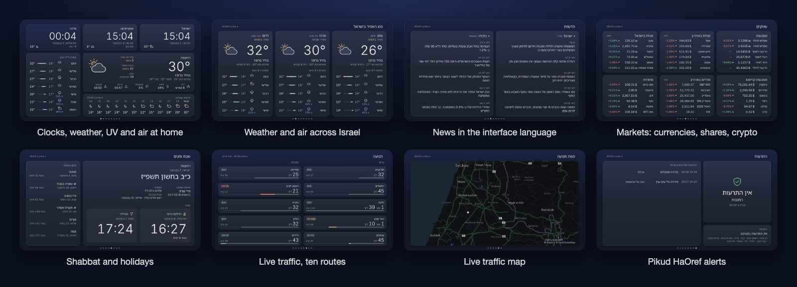
</p>

## 📺 Supported TVs

Home Dashboard supports Samsung Smart TVs across the whole range: from models almost 10 years old (the 2017 generation,
Tizen 3.0) up to the newest current models. It is not an app only for old TVs. We keep the code compatible with the
oldest supported generation (Tizen 3.0, Chromium 47), so it also runs on older sets; there is one package for every
generation. It is developed and tested on the owner's 2017 Samsung UE50MU7000.

## Why it's special

| | |
|---|---|
| 🎵 **Plays under «Настин кинозал»'s music** | Open the player, start a channel, open the dashboard: the music keeps playing under the dashboard ([below](#plays-under-настин-кинозал)). Two apps, one family. |
| 📺 **An installed app for every Samsung generation** | A signed Tizen `.wgt` for Samsung Smart TVs from 2017 to the newest models, kept compatible down to Tizen 3.0 / Chromium 47 (tested on the owner's UE50MU7000): plain ES5, no framework, no bundler, no backend. |
| 🌍 **Three languages, full right-to-left Hebrew** | Русский · עברית · Українська on ▲ / ▼, at once, no reload. Hebrew mirrors the whole layout; each language has its own news sources, and the holiday, month and parasha names are our own translations. |
| 📈 **Markets at a glance** | Six cards of six rows: the shekel against the dollar, euro, hryvnia and ruble, US and Israeli shares, crypto, US indices and commodities, each with the day's change. Asked only while the screen is on view. |
| 🕯️ **Shabbat and holidays for your city** | Candle lighting and havdalah by your city's own custom, the week's parasha with its Torah verses and haftarah (and a special Shabbat, Shabbat Mevarchim or the Omer count when there is one), the Hebrew date and the next six holidays and fasts with a countdown. One Hebcal request a day. |
| 🌬️ **Air, dust and UV** | Today's highest UV index and the European air-quality index at home, an air chip on every Israel region, and a dust warning when a khamsin comes in. |
| 🚗 **Live Israeli traffic** | Ten routes from your home city (Rehovot by default) with Mapbox `driving-traffic` times and the delay against a typical day, plus a live traffic map around home. |
| 🚨 **Pikud HaOref alerts everywhere** | Checked every 5 seconds; an alert in your home city opens the Alerts screen at once, red and full, with an attention sound, and a red line «Тревога в Реховоте» stays at the top of every other screen; a quiet line for nearby towns, an Alerts screen with the recent alerts in Israel, and a safe preview on the blue key. Never a false "all clear". |
| 🔄 **Fresh when you look** | Every screen you open with ◀ ▶ — or change the language on — refreshes its data at once. |
| 🛡️ **Free tiers never exceeded** | Every Mapbox request is reserved in the TV's storage before it is sent, under a cap per UTC date, so any 31 days stay inside the free month. |
| ✨ **Apple-like glass design** | Calm dark cards, Inter and a bundled Noto Sans Hebrew, nothing smaller than 24 px, burn-in care (the layout drifts a few pixels every 3 minutes). |
| 🔒 **No tracking, one key, never in the repo** | No backend, no sign-up, no analytics. The only key is the Mapbox public token for the two traffic screens; it goes into the packaged copy only, and a test pins the placeholder. Every other source (Open-Meteo, Yahoo Finance, open.er-api, Hebcal, Pikud HaOref, the news feeds) needs no key — see [Keys](#-keys-only-one-for-traffic). |
| ✅ **Tested and reviewed** | 460 automated tests (unit + every screen in every language in headless Chrome); every batch went through independent review (the "Fix batch" commits). |

## Plays under «Настин кинозал»

Home Dashboard is the companion app to **[«Настин кинозал»](https://github.com/yaroslavrudenko/nastin-kinozal)**, the IPTV player for
the same TVs: the player brings the channels, the dashboard sits on top with the time, weather, news, markets, Shabbat times,
traffic and alerts — while the music plays on.

1. Open «Настин кинозал» and start a channel.
2. Open Home Dashboard.
3. The music keeps playing under the dashboard. Leave the dashboard for YouTube or any other app and the player stops,
   as it always does.

How: on start and on every return to the front, the dashboard sends `play-behind` to the player's Tizen message port
`kinozal.control` (twice, 1.5 s apart, in case the player has not yet handled its own "hidden" event); when the dashboard
leaves the front it sends `stop-behind`. If the player is not installed or not running, nothing happens
([`js/player-behind.js`](js/player-behind.js)). Verified by the owner on his UE50MU7000 on 2026-10-30.

## See every screen

<table>
  <tr>
    <td>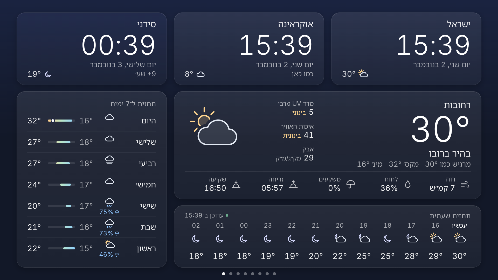</td>
    <td>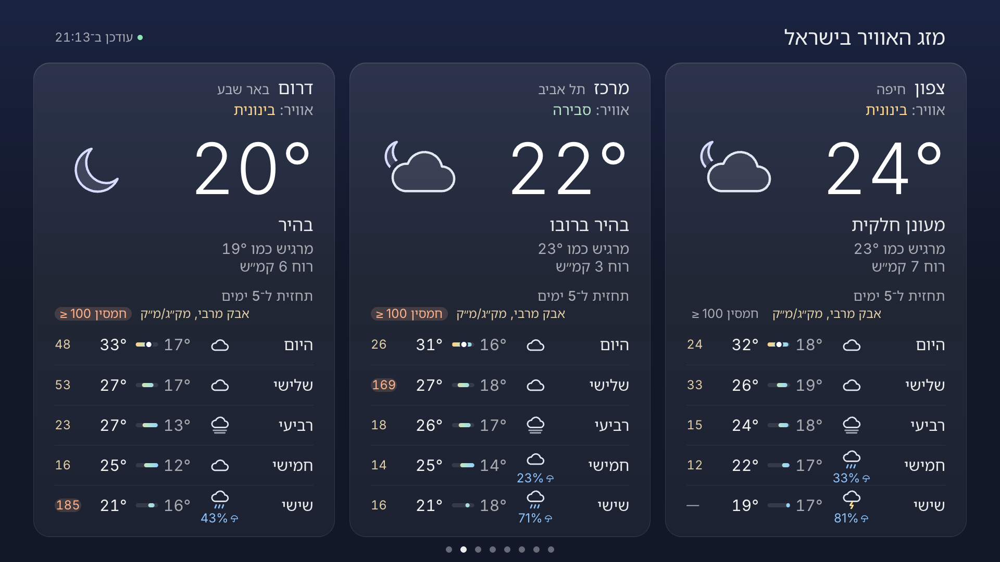</td>
  </tr>
  <tr><td align="center"><b>1 · Home</b> — clocks, the weather, air and UV at home</td><td align="center"><b>2 · Weather in Israel</b> — North, Centre, South</td></tr>
  <tr>
    <td>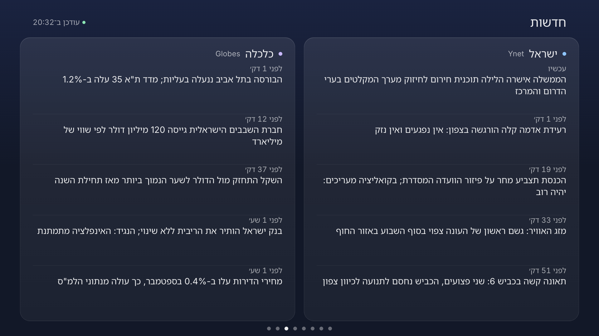</td>
    <td>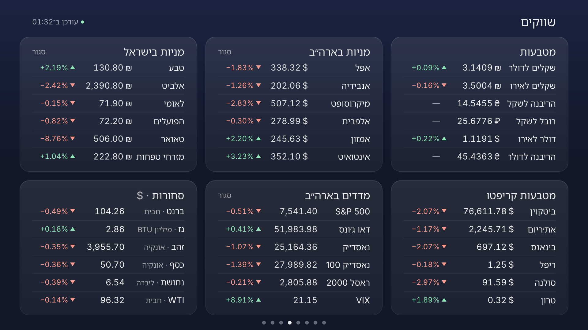</td>
  </tr>
  <tr><td align="center"><b>3 · News</b> — the sources follow the language</td><td align="center"><b>4 · Markets</b> — six cards, the day's change</td></tr>
  <tr>
    <td>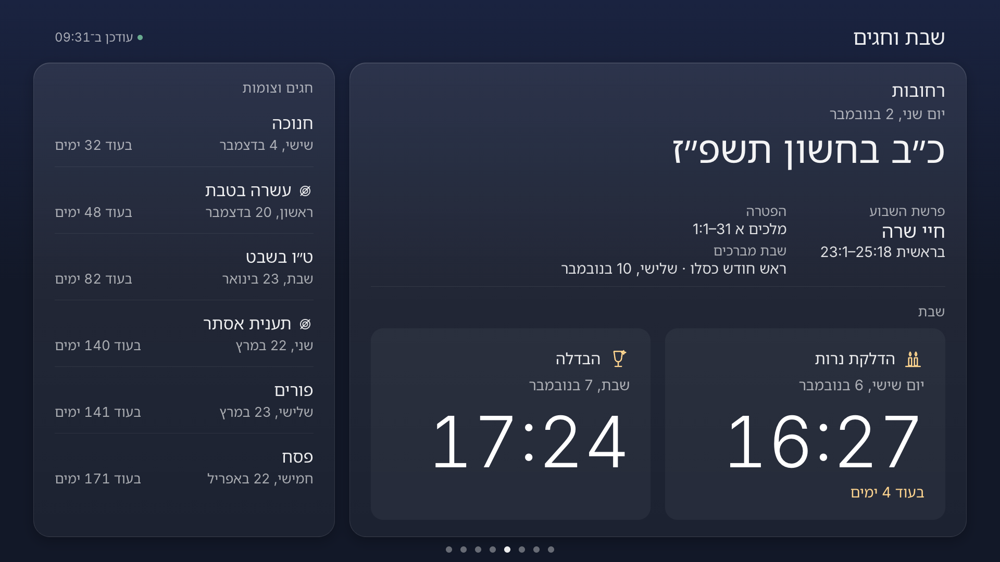</td>
    <td>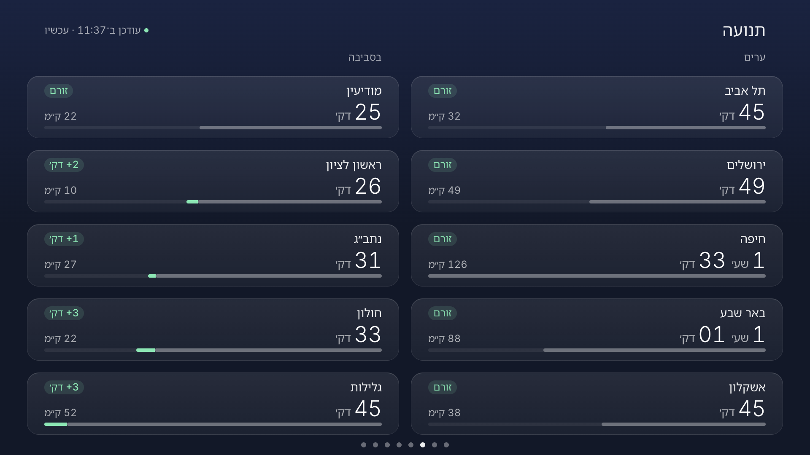</td>
  </tr>
  <tr><td align="center"><b>5 · Shabbat &amp; holidays</b> — the reading, candles, havdalah, what is next</td><td align="center"><b>6 · Traffic</b> — ten routes, live</td></tr>
  <tr>
    <td>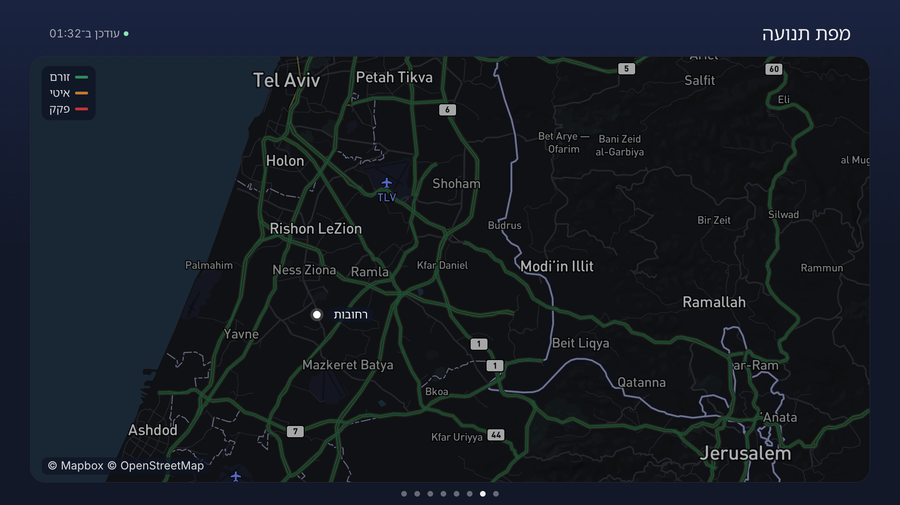</td>
    <td>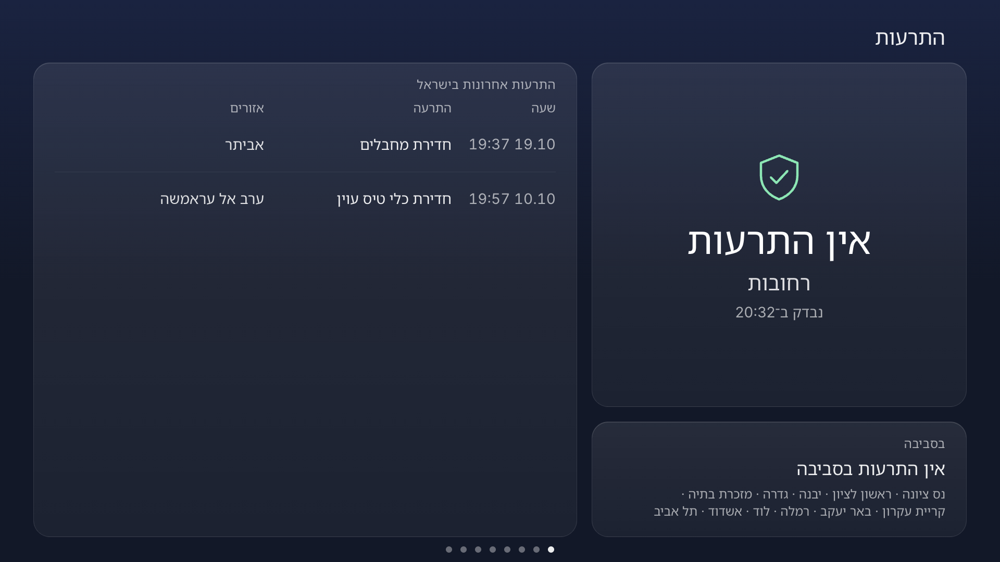</td>
  </tr>
  <tr><td align="center"><b>7 · Traffic map</b> — a real Mapbox picture</td><td align="center"><b>8 · Alerts</b> — home, nearby, recent alerts in Israel</td></tr>
  <tr>
    <td>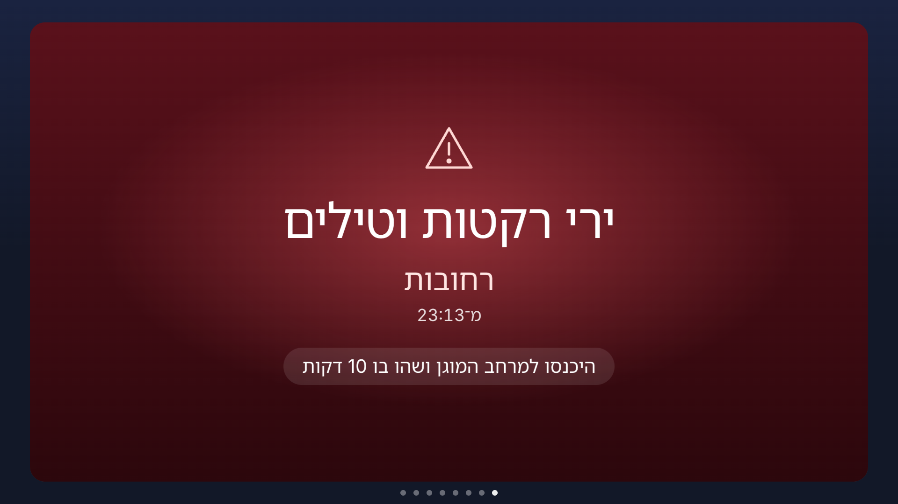</td>
    <td>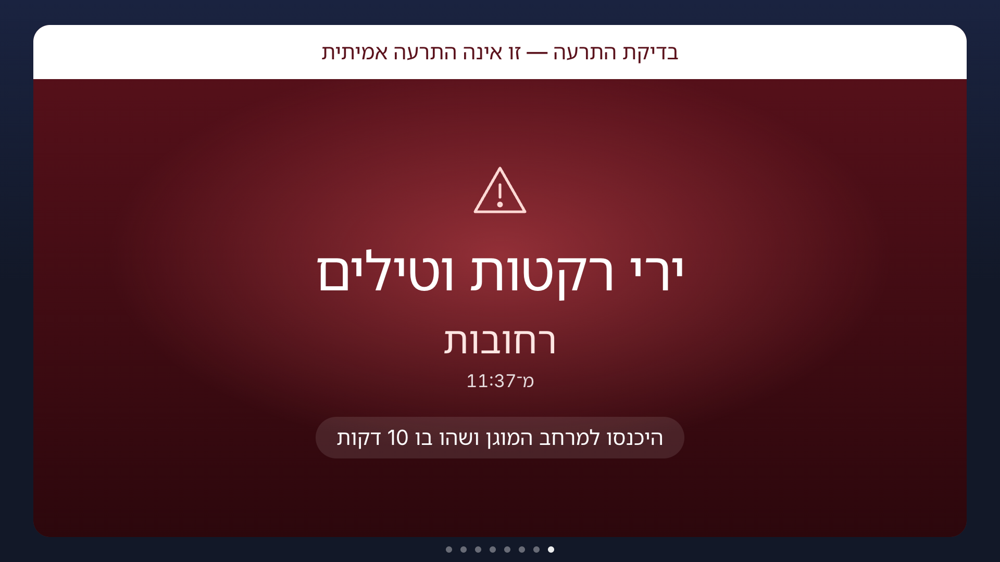</td>
  </tr>
  <tr><td align="center"><b>The alert</b> — the Alerts screen opens by itself</td><td align="center"><b>The alert preview</b> — the blue key, clearly not real</td></tr>
  <tr>
    <td>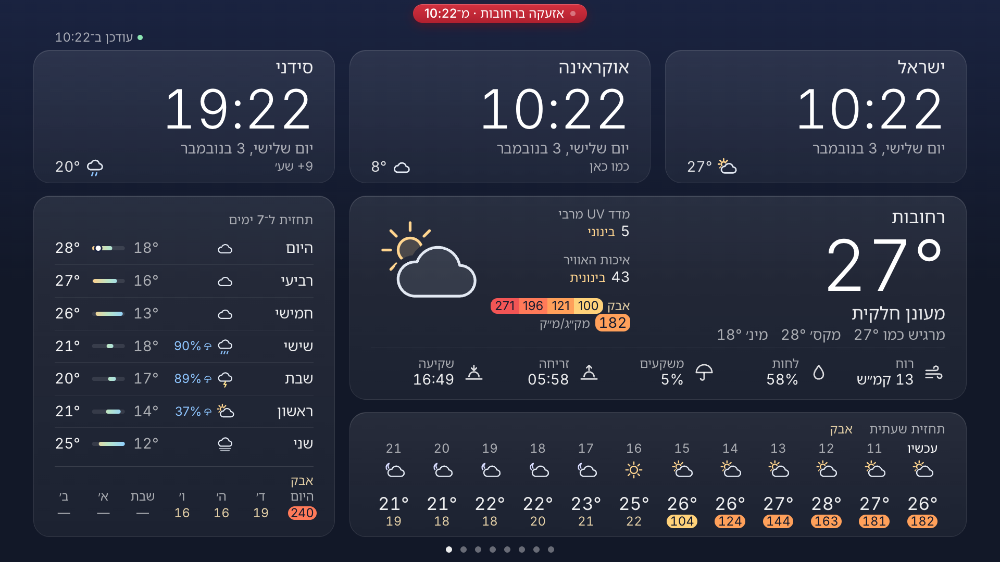</td>
    <td>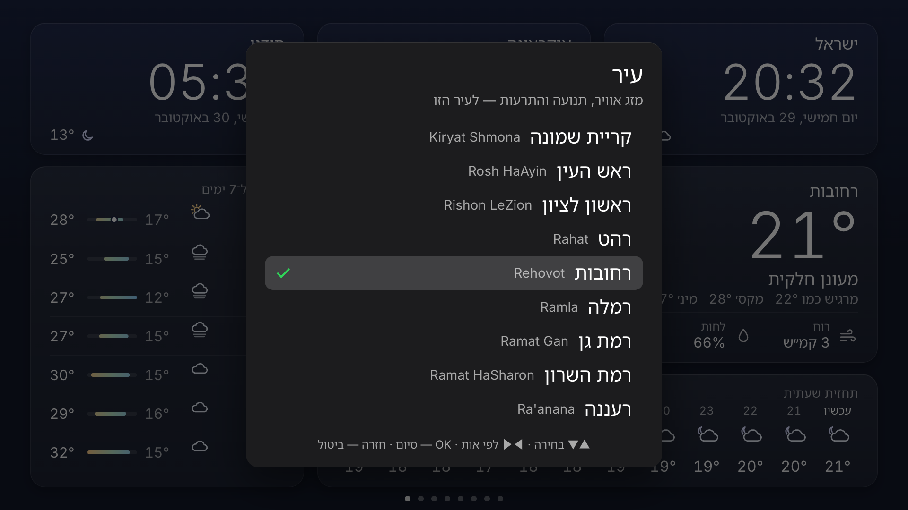</td>
  </tr>
  <tr><td align="center"><b>Alert banner</b> — stays on top of every other screen</td><td align="center"><b>Home city</b> — OK opens the picker</td></tr>
</table>

**Languages** — the same app in Russian and Ukrainian:

<table>
  <tr>
    <td>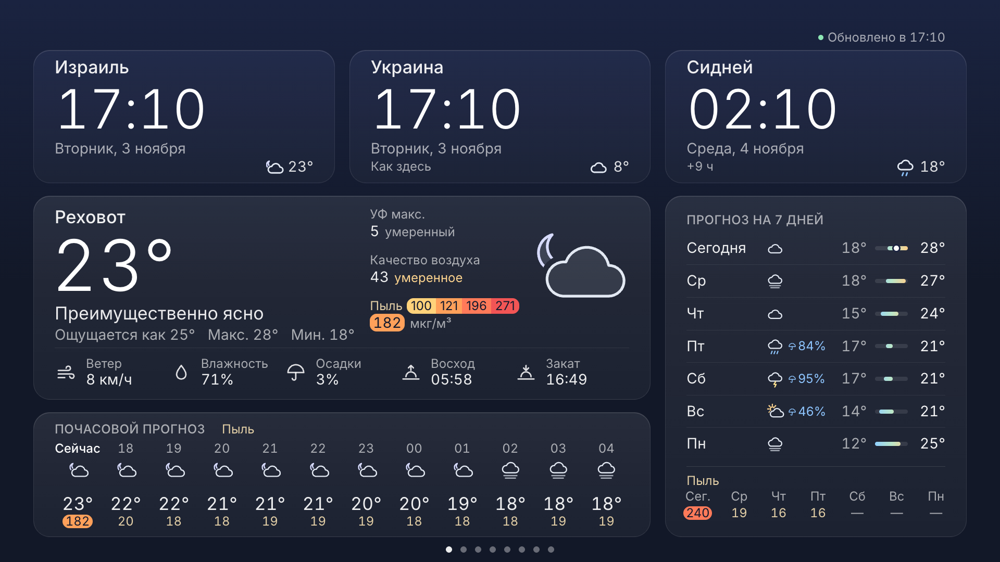</td>
    <td>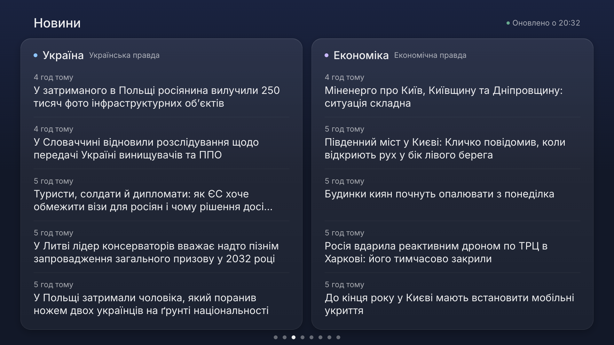</td>
  </tr>
  <tr><td align="center">Русский</td><td align="center">Українська</td></tr>
  <tr>
    <td>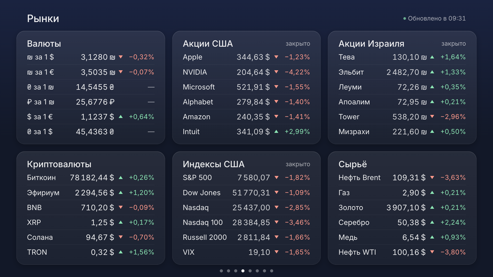</td>
    <td>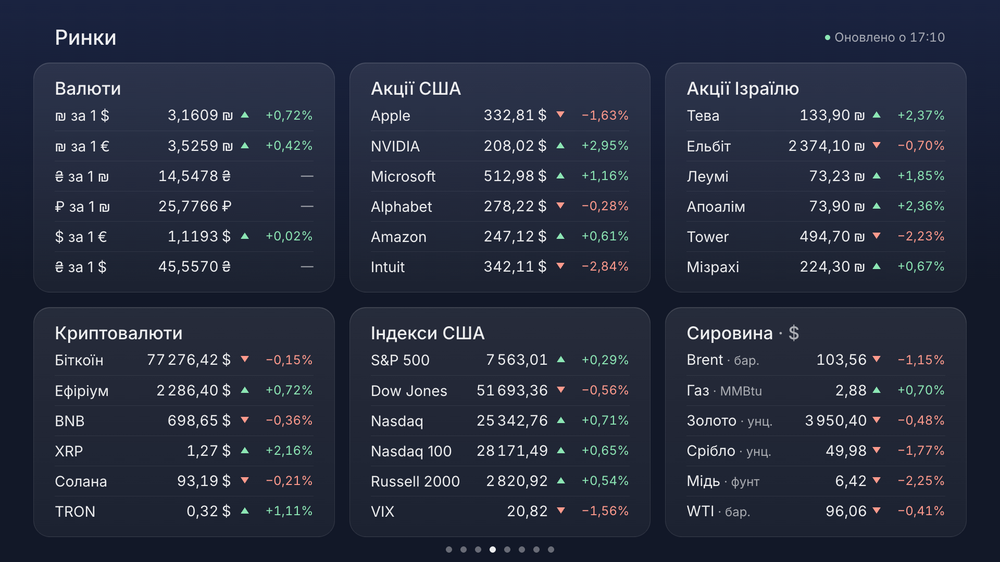</td>
  </tr>
  <tr><td align="center">Русский · Рынки</td><td align="center">Українська · Ринки</td></tr>
</table>

<sub>Screenshots at 1920×1080 in desktop Chrome (<code>tools/readme-shots.mjs</code>). The traffic map is a real Mapbox image captured on 2026-10-30;
the other screens use the test fixtures, so the headlines, temperatures, prices and travel times are sample data. The recent alerts on
the Alerts screen are Pikud HaOref's real answer recorded on 2026-10-30. The Markets and Shabbat screens and the air quality show
real answers recorded on 2026-11-02 (Yahoo Finance and open.er-api at 08:57 UTC; Hebcal's calendar for Rehovot), drawn at
09:31 that morning.</sub>

It is a real installed **Tizen web app** (a signed `.wgt` package), not a web page: the TV's browser is
slow and limited, while an installed app starts instantly, keeps the screen on and exits with Back.
It runs on Samsung Tizen TVs from 2017 up to the newest models (Tizen 3.0 or newer; 2016 models run Tizen 2.x and refuse the
package). The code stays compatible with the oldest supported generation, Tizen 3.0 with Chromium 47 (the owner's 2017
UE50MU7000, on which it is tested), so it is plain ES5 with
no framework, no bundler and no backend. The typeface, [Inter](https://rsms.me/inter/), ships inside the
app (static Light / Regular / Medium, Latin + Cyrillic, and a 1 KB subset for the ₪ ₴ ₽ signs; about 97 KB), so the TV
shows the same type as the screenshot instead of whatever system font it has.

## What it shows

Eight screens, switched with the remote's ◀ ▶ and shown in turn (page dots at the bottom mark the current one):
Home → Weather in Israel → News → Markets → Shabbat & holidays → Traffic → Traffic map → Alerts. Each stays 45 seconds;
Markets stays 90 (`rotation.dwellMs`), so a full round takes 6 min 45 s. Any key pauses the rotation for two minutes;
`rotation.enabled: false` in the config turns it off. A screen that is not on view keeps its content and costs nothing: it
is redrawn when it comes in. The TV behaves the same on Shabbat: the same rotation, every screen (the owner's ruling,
2026-11-02).

A screen opened with ◀ ▶ — or on view when you change the language — refreshes its data at once (the owner's rule,
2026-10-30): the weather and the air quality for the home and Israel screens, both news feeds, the markets, the Shabbat
calendar, the traffic round (within its daily cap), a new map image (within its own), the recent alerts. A request already
running is never started twice, a held ▲ / ▼ refreshes once (0.6 s after the last press), and a rotation arrival keeps each
screen's own schedule. Measured on 2026-11-02 (headless Chrome, live answers): a ◀ ▶ open of Home or Israel asks the
forecast and the air quality together (+2), an open of the Shabbat screen asks Hebcal (+1).

### What it asks, and how often

| Source | Screen | When | Requests |
|---|---|---|---|
| Open-Meteo forecast (with UV) | Home, Israel | every 15 min, and on an open | 1 for all six places |
| Open-Meteo air quality | Home, Israel | every 60 min, and on an open | 1 for the home city and the three regions |
| News feeds | News | every 10 min | the language's 2, in parallel |
| Yahoo Finance + open.er-api | Markets | only while on view: on an open, then every 5 min | 4 cold, 2 while the daily rates are current, 0 off view |
| Hebcal | Shabbat & holidays | once a day, on an open, and on waking with old data | 1 |
| Mapbox Directions | Traffic | only while on view, at most every 10 min, ≤ 3,000 a UTC date | 10 per round |
| Mapbox Static Images | Traffic map | only while on view, every 5 min, ≤ 600 a UTC date | 1 |
| Pikud HaOref, live | every screen | every 5 s | 1 |
| Pikud HaOref, history | Alerts | only while on view, every 2 min | 1 |

At start the app sends **6 requests in one parallel round**: the forecast, the air quality, the two news feeds of the
language, Hebcal and the alert feed (measured on 2026-11-02 with live answers, and pinned by a browser test).

**1 · Home**

- **World clocks**: Israel (Asia/Jerusalem), Ukraine (Europe/Kyiv) and Sydney (Australia/Sydney), in 24-hour
  time with the weekday, the date, the difference to Israel and each city's current temperature. A card is
  tinted for the night from that city's sunrise and sunset.
- **Weather** for the home city (Rehovot by default; see [Home city](#home-city)) from [Open-Meteo](https://open-meteo.com/) (free, no API key): temperature, feels-like,
  condition, wind, humidity, today's high/low, chance of rain, sunrise/sunset, a 12-hour strip and a 7-day list.
- **Air and UV**, between the city and the big weather icon. «УФ макс.» is today's highest UV index with its level
  (низкий, умеренный, высокий, очень высокий, экстремальный); after sunset the level word is dimmed, because the day's peak
  is past. «Качество воздуха» is the European air-quality index with its level (хорошее up to 20, приемлемое to 40,
  умеренное to 60, плохое to 80, очень плохое to 100, опасное above). When the dust reaches 100 µg/m³ — twice the EU daily
  PM10 limit from dust alone, a khamsin — an amber line «Пыль · 240 мкг/м³» appears, even when the index itself is
  missing. Before the first answer the slot holds a placeholder; with no index it says «Нет данных», never a made-up level;
  old air data is dimmed. The block has a fixed width, so nothing moves when the dust line appears.
- **Status**: "Updated at HH:MM". When a refresh fails, the last good data stays on screen and is marked as
  not updating, with the time it is from; every temperature from that data (the main card and each clock
  card) is dimmed, and the amber status line says it once. With no data at all, the weather card says so once, with
  the time of the next attempt, and the forecast rows stay in place as quiet placeholders.

### Behaviour worth knowing

- **The time is never silently wrong.** The TV's own time-zone setting is not trusted: each clock takes UTC
  from the device and converts it with the zone's rules. Old TVs ship a 2015 time-zone database that does
  not know "Europe/Kyiv", so the app falls back to "Europe/Kiev". If the TV has no usable time-zone support
  at all, built-in daylight-saving rules for Israel, the EU and Sydney are used and the clock shows a small
  "≈". When the TV's time-zone data and the built-in rule disagree, the rule wins (it is tested against the
  real time-zone database for every hour of 2025–2030) and the disagreement is logged. If neither works,
  the clock says "Zone unknown" instead of a time.
- **Weather refresh**: every 15 minutes, ONE request for all places (Open-Meteo takes comma-separated
  coordinates); today's UV maximum rides in the same request, so it costs nothing more. After a failure it waits a
  random time between 30 seconds and 1, 2, 4 and 8 minutes, then up to 15 minutes, so it never loops tightly and never
  synchronises. Data older than 45 minutes is marked stale even if no request failed. "Now" and "Today" follow the clock,
  not the age of the data.
- **Air refresh**: ONE more request, to Open-Meteo's air-quality API, for the home city and the three Israel regions
  together, every hour (the data are hourly), with the same back-off as the weather. Air data older than 3 hours is
  marked stale.
- **Burn-in care**: the whole layout drifts by a few pixels every 3 minutes, slowly (6 s), so static text
  never sits on the same pixels for hours. The layout is its own GPU layer, so a drift repaints nothing.
- **Screen saver**: switched off while the app runs (the result is logged); **Back** closes the app.
  The TV's own **Eco "Auto Power Off"** is separate and an app cannot override it: it switches the TV off
  after about 4 hours without a remote key press. For an always-on dashboard turn it off in
  *Settings → General → Eco Solution → Auto Power Off*. Not yet verified on the TV for a run longer than 4 hours.
- **Languages**: Russian, Hebrew and Ukrainian, switched with ▲ / ▼ (see [Languages](#languages)).

**2 · Weather in Israel**: three cards side by side — North (Haifa), Centre (Tel Aviv), South (Beer Sheva) — each
with the temperature now, its condition, feels-like and wind, and a 5-day list with the same range bars as the
main card. The head of each card ends with an air chip: the air glyph and the level word in its colour, or «пыль» when the
dust is high (even with no index). The regions ride the main weather's single Open-Meteo request (six places, one
request) and the home screen's air request (four places, one request), so this screen costs no request of its own; a
failed refresh dims every card and the header says it once.

**3 · News**: two columns, five headlines each, newest first, with how long ago. The interface language picks the
sources (see Languages): in Russian «Израиль» and «Экономика» from [NEWSru.co.il](https://www.newsru.co.il/) (its Israel
and Economy sections), in Hebrew «ישראל» from [Ynet](https://www.ynet.co.il/Integration/StoryRss2.xml) and «כלכלה» from
[Globes](https://www.globes.co.il/) (Calcalist's feeds answer 403, TheMarker's stopped in May 2026), in Ukrainian
«Україна» from [Українська правда](https://www.pravda.com.ua/) and «Економіка» from [Економічна правда](https://epravda.com.ua/)
(every feed checked live on 2026-10-30). Only the language's two feeds are fetched, in one parallel round every 10 minutes;
a story a feed repeats is shown once, and feed text is reduced to plain text (no feed HTML ever reaches the screen). A
headline takes at most two lines (a fixed two-line box; a longer one ends with an ellipsis), and row n of both columns
sits on one line. Both columns are always there: while a feed loads its own column says «Загружаем новости…»; a feed that
fails with nothing yet says so in amber in its own column, with when it is tried again («Не удалось загрузить · повторим в
HH:MM»). A feed that fails keeps its last stories and says "not updating" in its own column
only, while the header stays "Updated at"; when nothing came at all the header says «Новости временно недоступны · повторим
в HH:MM». Hebrew is drawn in a bundled Noto Sans Hebrew (Regular, the Hebrew block only, about 7 KB, OFL) so the TV does not
depend on its system fonts for it.

**4 · Markets**: six glass cards in a 3 × 2 grid, six rows each, all the same height. Top row: currencies, US shares,
Israeli shares; bottom row: crypto, US indices, commodities (mirrored in Hebrew).

| Card | Rows |
|---|---|
| Currencies | ₪ for 1 $ · ₪ for 1 € · ₴ for 1 ₪ · ₽ for 1 ₪ · $ for 1 € · ₴ for 1 $ |
| US shares | Apple, NVIDIA, Microsoft, Alphabet, Amazon (the five largest US companies by market cap) + Intuit |
| Israeli shares | Teva, Elbit Systems, Leumi, Hapoalim, Tower, Mizrahi Tefahot (the six largest on the Tel Aviv exchange) |
| Crypto | Bitcoin, Ethereum, BNB, XRP, Solana, TRON (the six largest by market cap, no stablecoins), in $ |
| US indices | S&P 500, Dow Jones, Nasdaq, Nasdaq 100, Russell 2000, VIX |
| Commodities | Brent oil, natural gas, gold, silver, copper, WTI oil |

The lists were checked on 2026-11-02 (`tests/fixtures/markets/ranking.json`); they live once, in `Config.markets`.

- **Each row**: the name in the interface language, the price and the day's change with a soft green ▲ or a soft red ▼.
  Every price in a card sits on one numeric grid: the currency sign in its own column, currencies to 4 decimals, indices
  and crypto to 2 (a coin under 1 to 4). The Tel Aviv exchange quotes in agorot; the app divides by 100 and shows ₪.
- **No day change from the source** (the hryvnia and ruble rows come from a daily table): a muted «—» in its place,
  never a made-up figure.
- **Closed markets** are said once, in the card's head: «закрыто» when every quote with trading hours is closed,
  «частично закрыто» when some are; each closed price is dimmed. The daily-table rows have no trading hours and never
  count, so on a weekend the currencies card still reads «закрыто».
- **When a source fails**, a row keeps its last good price, dimmed, until the next good round. A row that never had a value
  says «нет данных»; when a whole card has nothing, its head says «нет данных» in amber and its rows show «—». The header
  says «Обновлено в HH:MM»; «Не обновляется · данные от HH:MM» after a failed round or 15 minutes without new data; and
  «Котировки временно недоступны» when no price came at all.

Sources, both without a key (checked 2026-11-02): [Yahoo Finance](https://finance.yahoo.com/)'s spark endpoint for 33
symbols in 2 batched requests (it takes at most 20 symbols per request; 21 answer 400), and
[open.er-api](https://open.er-api.com/)'s daily ILS and USD tables for the hryvnia and the ruble (Yahoo has no shekel pair
for them, and its `UAH=X` reported 0.0% on a +3% day). A rate table is reused until the time the provider names for its
next update, at most 24 hours. That makes **4 requests cold, 2 while the daily rates are current, and 0 while the screen is
off view**: the markets are asked only while the screen is on view (at once on a ◀ ▶ open or a language change, else every
5 minutes, one round at a time with a 15-second deadline). The quotes appear as soon as Yahoo answers, without waiting for
the rate tables.

**5 · Shabbat & holidays**: the home city's calendar on two cards.

- **The week** (the wide card): the city, today's date, today's Hebrew date («22 хешвана 5787»; in Hebrew «כ״ב בחשון
  תשפ״ז»), then the week's reading, then «Шабат» with two tiles: candle lighting and havdalah, each with its day and time, and
  how long until the candles («через 4 дн.»; on the day itself «через 2 ч 14 мин»). From candle lighting on the eve of
  Shabbat or a holiday, the Hebrew date is already the next day's, because the holy day has begun.
- **The reading**, every value under its own label: «Недельная глава» — the parasha («Хаей Сара») with its Torah verses
  («Берешит 23:1–25:18»); «Афтара» — the haftarah («Мелахим I 1:1–31»). On a festival the label is «Чтение Торы» and the
  festival's own reading is shown. One more labelled line when there is one: a special Shabbat («Особый шабат · Шабат
  Шира»), «Шабат мевархим» with the coming Rosh Chodesh and its date, Rosh Chodesh on Shabbat, or else today's «Счёт
  омера · день 3». The books are named in each language (Берешит, Шмот…; בראשית, שמות…), the verse numbers stay left to
  right, and a long reference breaks only between its parts. Only what Hebcal gives is shown; nothing is invented.
- **A note line** for a fast («Пост 10 тевета · начало 05:18 · конец 16:55», amber while it runs) or the holiday today
  («Сегодня: Ханука»).
- **While Shabbat or a yom tov is in**, the card turns calm: «Шабат шалом», «Хаг самеах» or, on Yom Kippur, «Гмар хатима
  това», the week's reading above (or its name said once when there is no reading), and havdalah («Авдала · 17:24» when it is today). A Shabbat next to a yom tov is shown
  as Shabbat on Shabbat and as the holiday on the holiday.
- **Holidays and fasts** (the narrow card): the next six, each with its short date and a day count, quiet until a week or
  less is left, then amber; «идёт» while one runs; a fast carries the fast glyph. Shown: the festivals, Yom HaShoah, Yom
  HaZikaron, Yom HaAtzmaut and Yom Yerushalayim, and the public fasts. In Jerusalem the list shows Shushan Purim instead of
  Purim.

The source is [Hebcal](https://www.hebcal.com/) (no key): ONE request a day carries the whole screen — candle lighting and
havdalah (havdalah at nightfall), the parashot with their Torah and haftarah readings, the special Shabbatot, Rosh Chodesh,
Shabbat Mevarchim, the Omer, the holidays, the fast times and a Hebrew date for every day, on the Israeli
schedule — from 9 days back (an ongoing holiday keeps its first day) to 180 days ahead (the shortest lookahead that always
fills the six rows). It is asked again when the screen is opened and when the TV wakes with old data; a failure is retried
after 1, 2, 4 and 8 minutes, then every hour, never only the next day. The data covers half a year, so the screen recomputes
"now" and "today" every minute from what it holds; a missed refresh never shows a wrong time. Every name comes from our own
tables in each language, so a language switch costs no request.

**6 · Traffic**: ten widgets in two columns of five, all from the home city. For Rehovot (the default) «Города»: to the
centres of Tel Aviv, Jerusalem, Haifa, Beer Sheva and Ashkelon; «Рядом»: to Modi'in, Rishon LeZion, Ben Gurion Airport
(Terminal 3), Holon and Glilot (Cinema City). Any other home city gets five of Tel Aviv, Jerusalem, Haifa, Beer Sheva,
Ashkelon and Netanya (never itself) and its five nearest cities (see [Home city](#home-city)). Each widget: the name and a soft green / amber / red chip with the delay, the travel time now and the length, and a
time bar (bars compare within a column). The times are LIVE traffic from the
[Mapbox Directions API](https://docs.mapbox.com/api/navigation/directions/) (profile `driving-traffic`): one GET per route,
the ten started together, no geometry. The delay is the time now over the usual time at this hour (`duration_typical`);
a trip faster than usual says «Свободно». Mapbox's free tier is 100,000
Directions requests a **month**, so one rule decides when a round is sent (`Config.traffic.schedule`; one function,
`Traffic.decide`, for every path), at any hour of the day:

- only while the traffic screen is on view and the TV shows it (a hidden screen costs nothing, nothing is sent at boot),
  and one round at a time (20-second deadline per request);
- opened with ◀ ▶: at once, every time, however old the data is;
- arrived with the rotation, staying open, or the TV waking: at most once every 10 minutes since the last attempt
  (`minIntervalMs`), failures and refusals included (no separate retry path, no catch-up);
- never past 3,000 requests (300 rounds) on a UTC date (`dailyRequestCap`): before every round the app writes
  `{utcDate, used + 10, lastAttemptAt}` to the TV's localStorage (`tt-quota`), reads it back, and sends only if it was
  stored; nothing is refunded (a failure, a timeout, a refusal, a restart). Any 31 days (with arbitrary alignment they
  touch 32 UTC dates) stay ≤ 32 × 3,000 = 96,000 requests; parked on the screen it is 144 rounds a UTC date (1,440
  requests), and pressing ◀ ▶ every minute all day stops at exactly 3,000 (`tests/build-config.test.js` simulates these,
  restarts and the 25-hour DST date included).
- A deadline Mapbox gives (`Retry-After` on a 403, 429 or 503 of any of the ten answers, in seconds or as a date) is
  written into the same record (`retryNotBefore`, read back) and holds for every path, ◀ ▶ opens and restarts included;
  the refusal line shows the later of "last attempt + 10 min" and that deadline («автоматический повтор не раньше HH:MM»).
- A clock that went back is corrected without sending: a last attempt in the future becomes "now" (the next round 10
  minutes later), a counter date in the future becomes today's UTC date with its count kept. If localStorage fails or the
  counter is corrupt, nothing is sent and the screen says «Обновления пробок приостановлены: не удалось проверить или
  сохранить счётчик запросов».

The rows and their times are kept in localStorage (`tt-cache`) and shown at once after a restart. The header says when the
data on screen is from, always the OLDEST row: «Обновлено 20:32 · 3 мин назад», while a round runs «Обновляется… · данные
от 20:32», after 30 minutes or a failed update «Данные устарели · обновлено 20:32 · 41 мин назад» (a date «29.10» before
the time when it is not today), and data timed in the future «Данные устарели · время данных требует проверки» (never a
negative age). Why it cannot update is a second line under it, never in its place: «Дневной лимит запросов пробок исчерпан
· обновление после 30.10 02:00», «Mapbox отклонил запрос (доступ или лимит) · автоматический повтор не раньше 20:42» (401/403/429), or the
storage pause. With nothing to show, the card says «Обновляется…», «Не удалось обновить пробки» or the same message. A
place Mapbox cannot route (NoRoute / NoSegment) says «Нет данных» in its own widget and never marks the screen as not
current. It needs a Mapbox token (see Build); without one the screen says how to connect it and sends nothing. The routes
were checked live by the coordinator on 2026-10-30 16:28 (e.g. Tel Aviv 32.0 min vs a usual 39.3, Jerusalem 44.9 vs 56.4);
the tests run on Mapbox's documented answer shape.

**7 · Traffic map**: the live traffic around the home city (for Rehovot: Tel Aviv, Rehovot, Ashdod and Jerusalem; any other
city is in the middle) as ONE picture from
the [Mapbox Static Images API](https://docs.mapbox.com/api/maps/static-images/) in Mapbox's live-traffic style
(`traffic-night-v2`: green, orange and red lines over a night map), with the same Mapbox token as the routes. A white dot
marks the home city (placed by Web Mercator, so it sits exactly on the town), and the card carries the attribution Mapbox requires,
«© Mapbox © OpenStreetMap». The picture is asked for at half the card's size `@2x`, so it fills the card pixel for pixel.
It is refreshed while it is shown (the same one-gate rule as the routes, `Config.map`): at once on every ◀ ▶ open, every
5 minutes while the map is on view and the TV shows it, never while hidden (leaving the screen or the TV hiding the page stops
the image in flight), one image at a time with a 20-second deadline. A failed image keeps the last one on screen and the
header says «Карта недоступна · данные от HH:MM». Each image is reserved in the TV's localStorage (`map-quota`) before it is
asked for and never refunded, at most 600 a UTC date: Static Images' free tier is 50,000 a month, and any 31 days touch at
most 32 UTC dates, so ≤ 32 × 600 = 19,200. The map's place names come from Mapbox, in English.

**8 · Alerts**: the [Home Front Command](https://www.oref.org.il/) (Pikud HaOref) on one calm screen. At the start, home:
a green shield and «Тревог нет · Реховот» with the time the feed last answered («Проверено в 20:32»); while an alert is up, its
kind, areas and start time; while the feed is lost, «Тревоги: нет связи · последний ответ HH:MM» in amber — never "no
alerts". Under it, the nearby towns («Рядом тревог нет», or the towns with an alert now). At the end, the **recent alerts in
Israel**, newest first: the time (with the date when it is not today), the kind in the interface language and the areas
(configured towns in the language, others as Pikud HaOref writes them, in Hebrew), up to seven rows, with «За последние 7
дней тревог не было» on a quiet week. That list comes from Pikud HaOref's history feed
(`alerts-history.oref.org.il/Shared/Ajax/GetAlarmsHistory.aspx?lang=he&mode=2`, the last 7 days, checked 2026-10-30: a
plain GET answers 200 with one JSON record per area; `www.oref.org.il/…/AlertsHistory.json` answers 403). Records of one
siren are one row; "the event has ended" and "the threat has been removed" are not rows. It is asked for only while this
screen is on view and the TV shows it: at once on a ◀ ▶ open or a language change, then every 2 minutes (the feed itself is
cached for 2), never while hidden; a failed answer keeps the last list and the header turns amber.

**Israel alerts**: the live alert feed is read every 5 seconds (one request at a time, 4-second timeout). What happens
depends on where the alert is:

- **The home city (Rehovot by default, `alerts.areas`).** The moment an alert starts, the app switches to this screen from whatever screen is
  on view, and the screen itself becomes the alert: deep red, filling the screen, with the kind of alert, the area, the
  time it started and the instruction. The recent alerts refresh at once, as on a ◀ ▶ open. A short attention chime
  (three soft bell tones, about 2 s) plays at the start and again every
  30 seconds while the alert is up, five times at most (`alerts.sound`: `enabled`, `repeatMs`, `maxPlays`). The rotation
  stops while the alert is up and for 2 minutes after it clears (`rotation.afterAlertMs`), then carries on from this
  screen. Only the START of an alert switches and rings: if you leave with ◀ ▶, a new record of the same alert does not
  pull you back; while the alert is up every other screen carries a slim red line at the top, «Тревога в Реховоте · с
  20:32» («אזעקה ברחובות · מ־20:32», «Тривога в Реховоті · з 20:32»), never for the preview. The chime is made on the
  spot with Web Audio (`js/chime.js`, the recipe of `tools/make-chime.mjs`): on the TV the HTML5 media player may be busy
  with the music of «Настин кинозал» behind the dashboard, and Web Audio does not need it. Only where Web Audio is missing
  or fails is the bundled `sounds/alert.wav` played instead. The alert never ends on a guess: it stays for the instruction's minutes after the area was last listed
  (10 minutes when the instruction names none) and until the feed has answered without the area for a full minute; a
  failed or malformed answer never counts as "not listed". An end message ("the event has ended") never clears or
  shortens it: end messages are recognised by exact title only so that they never raise one. The remote cannot dismiss
  it (Back still closes the app).
- **Nearby towns (`alerts.nearby`: derived from the home city).** A quiet line in the corner and in this screen's «Рядом» card; no switch, no sound.
- **Anywhere else in Israel.** Only in this screen's list of recent alerts; nothing else on screen, no sound.

- **Hebrew original.** In Russian and Ukrainian the kind is in the interface language; when the screen has no word for
  the kind, Pikud HaOref's Hebrew title is shown under it as its own right-to-left line (figures stay where Hebrew puts
  them, e.g. «… מספר 12»), and an instruction the screen cannot translate is shown the same way. In Hebrew the alert's own
  words are the main line (nothing translated twice).
- **Area names in three languages.** Areas come from the city catalogue `js/cities.js`: each city's Hebrew name and the
  Pikud HaOref names its alerts are matched against (`match`: «קריית גת, כרמי גת» for Kiryat Gat, the «מודיעין - …»
  centres for Modi'in), spelled as in Pikud HaOref's area list (a test checks every name against a copy of it in
  `tests/fixtures/oref/`), each with its Russian and Ukrainian name; a name never breaks at its hyphen. A district in the
  recent-alerts list («ראשון לציון - מזרח») is named as its city.
- **Nearby corner line.** Bottom-right (bottom-left in Hebrew); three names at most, «и ещё N» for the rest.
- **No connection.** If the feed cannot be reached three times in a row, the corner says «Тревоги: нет связи · последний
  ответ 20:32» (the time of the last good answer; just «Тревоги: нет связи» before the first one, or when the line would
  not fit next to nearby towns — their names come first), and during an alert the alert itself says so. The app never
  claims "all clear". The feed answers only inside Israel.
- **Alert preview (the blue key).** Press the remote's **blue** key to see how an alert looks: the Alerts screen opens
  and shows the alert for 10 seconds (`alerts.previewMs`) with a sample record for the home city (rocket and missile fire, stay 10
  minutes) under a white band «Проверка тревоги — это не настоящая тревога» (in Hebrew «בדיקת התרעה — זו אינה התרעה
  אמיתית», in Ukrainian «Перевірка тривоги — це не справжня тривога»). Back or any other key ends it (and does nothing
  else). The chime plays once so you can hear it. The preview never touches the real alert state, and a real alert
  always wins: it replaces the preview at once (and rings), and the blue key does nothing while one is up.

## Home city

Everything that is about "here" follows one city: the main weather card (and the Israel clock's temperature), the air
quality and UV at home, the Shabbat & holidays screen, the ten traffic routes and their names, the traffic map's centre and
dot, the alert at home, the nearby towns and the red alert line.
Rehovot is the default; 83 Israeli cities are in the catalogue [`js/cities.js`](js/cities.js) (every city of roughly 20,000
people or more, plus the small towns around Rehovot).

- **On the TV.** Press **OK**: a sheet lists the cities in the interface language's order, the current one ticked. **▲ ▼**
  move, **◀ ▶** jump to the next / previous letter, **OK** chooses, **Back** (or 30 seconds without a key) closes it with no
  change. A new city is saved on the TV and the app restarts once (about a second), then a toast says «Город: Хайфа». The
  sheet never opens over an alert, and a real alert closes it.
- **At build time.** For a TV in another city, add `HOME_CITY=<id>` to `build.local.env` (an id from `js/cities.js`, e.g.
  `haifa`, `tlv`, `jlm`, `beersheva`). The build writes it into the packaged `js/config.js` only; an id that is not in the
  catalogue stops the build.
- **Which wins.** The city chosen on the TV, then `HOME_CITY` (`homeCity` in `js/config.js`), then Rehovot. Rebuilding with
  a new `HOME_CITY` does not override a city already chosen on that TV; choose again with OK.
- **What a city gets.** Rehovot keeps the owner's hand-tuned routes, map view and nearby towns exactly. Any other city:
  «Города» are five of Tel Aviv, Jerusalem, Haifa, Beer Sheva, Ashkelon and Netanya (never itself); «Рядом» are its five
  nearest cities (at least 2 km away); the map is centred on it; the nearby alerts are the cities within 20 km (11 at
  most; with fewer than 3, the 3 nearest within 40 km). Remote towns are honest: Eilat's «Рядом» are far away and it has no
  nearby alert towns.
- **Candle lighting by the city's own custom.** 78 of the 83 cities carry their GeoNames id (checked 2026-11-02), so
  Hebcal applies the city's own custom: Jerusalem lights 40 minutes before sunset (measured on the design day: 16:11 by id
  against 16:25 by coordinates). Beitar Illit and Modi'in Illit have no id; they are asked by coordinates with the same
  40 minutes. Umm al-Fahm, Tayibe and Ma'ale Adumim are asked by coordinates with Hebcal's default. In Jerusalem the
  holiday list shows Shushan Purim instead of Purim.
- **The cost.** A change of city costs no extra request of any kind: still 10 Mapbox requests per traffic round and 1 map
  image, both only while their screen is on view, under the same daily caps; still one air request and one Hebcal request.
  Travel times cached for one city are never shown for another.
- **Maintenance.** `node tools/cities.mjs --order` re-sorts the picker for every language; `node tools/cities.mjs --check`
  compares the catalogue with Pikud HaOref's live area list and Open-Meteo's geocoding (run it at every release: a renamed
  Oref area would silently stop that city's home alerts).

## Languages

Русский · עברית · Українська. On the remote, **▼** switches to the next language and **▲** to the previous one
(ru → he → uk → ru); the **yellow** key (the red one if the TV refuses yellow) works like ▼. A short toast names the language
in its own words and every screen changes at once, with no reload; holding ▲ / ▼ never sends a burst of requests — only the
language you land on fetches its news, 0.6 s after the last press, and the screen on view refreshes once as if you had just
opened it. The choice is remembered on the TV (localStorage); `lang`
in the config is only the first start's language, `languages` the order of the switch.

- **News follows the language**: Russian — Israeli news in Russian (NEWSru.co.il); Hebrew — the top Hebrew outlets (Ynet,
  Globes); Ukrainian — news about Ukraine in Ukrainian (Українська правда, Економічна правда). Only the active language's
  two feeds are fetched; a switch fetches the new ones at once (the columns say «Загружаем новости…» until they answer),
  plus the refresh of the screen on view.
- **Everything else is translated and laid out for the language**: clocks, dates and weekdays, weather words, the UV and
  air-quality levels, the Israel regions, the market names and currency directions («₴ за 1 ₪», «הריבנה לשקל»), routes,
  statuses, the map, the alerts. Hebrew mirrors the whole layout right to left (Israel's clock on the
  right, the forecast bars filling from the right, the market cards in mirrored order), while times, prices, temperatures
  and signed figures («+9 שע׳», «−4°») stay left to right; the page dots and ◀ ▶ stay physical (◀ is the previous screen,
  on the left).
- **Shabbat & holidays**: Hebcal is asked once, language-neutral, and every name on the screen comes from our own tables:
  20 holidays and fasts, the Hebrew months, the 59 weekly parashot, the 9 special Shabbatot and the 31 books named in
  the Torah and haftarah readings, in Russian, Hebrew and Ukrainian (a missing name
  shows Hebcal's id, never a blank). Hebcal's own Russian and Ukrainian lists leave the modern holidays in English and
  misspell some others, so they are not used. In Hebrew the Hebrew date («כ״ב בחשון תשפ״ז») and the parasha are the
  source's own strings. A language switch on this screen needs no new data.
- **Alerts**: in Hebrew the alert's own Hebrew words from Pikud HaOref are the main line (nothing translated twice); in
  Russian and Ukrainian the screen's own words, with the Hebrew original under them, right to left, when the kind is
  unknown. Areas are named in the language.
- Hebrew uses the bundled Noto Sans Hebrew (every Hebrew character in the strings is in it); Ukrainian letters (і, ї, є, ґ,
  ’) are in the bundled Inter, and so are the ₪, ₴ and ₽ signs. The Ukrainian city names and holiday, month and parasha
  names await a native speaker's check.

## Configure

Everything lives in [`js/config.js`](js/config.js): language, the home city (`homeCity`), screens and rotation (with a
screen's own dwell in `rotation.dwellMs`), clocks (zones and order), weather places (the first is the home city's main
card), the air quality (`air`: refresh and the dust threshold), news feeds per language, the markets (`markets`: the six
groups, their rows and sources, the refresh), the Shabbat calendar (`shabbat`: the lookahead, the holidays and fasts shown,
the refresh and retries), when the traffic routes are refreshed (`traffic.schedule`), the traffic map, the alert feed,
refresh intervals and burn-in timing. The routes, the map's view, the alert areas and the Shabbat place are derived from
the home city ([`js/cities.js`](js/cities.js), [`js/homecity.js`](js/homecity.js)). Names on screen are in `js/i18n.js`.

## Build, sign and install on any Samsung TV

You need a Samsung account, the Tizen CLI, and the TV in Developer Mode. The full walk-through, including
how to get Samsung certificates on a Mac and the `install failed[118]` trap, is in
[docs/DEPLOY.md](docs/DEPLOY.md). Short version:

```sh
cp build.local.env.example build.local.env   # fill in CERT_PROFILE, DEVICE_PROFILE, TV (and MAPBOX_TOKEN for traffic)
./build.sh --package                         # build + sign only → .buildResult/HomeDashboard.wgt
./build.sh                                   # build + sign + install on the TV + launch
```

`tools/find-tv.sh` finds the TV again when the router gives it a new address. It never guesses: when
several devices answer, it stops unless `TV_DUID` in `build.local.env` names the TV, and then it installs
only on the device that reports that DUID. `./build.sh` refuses any argument other than `--package` and
`--help` before it builds or connects to anything.

`MAPBOX_TOKEN` (a public token, `pk.…`, from account.mapbox.com) is put into the packaged copy of `js/config.js` only;
the repository keeps the `__MAPBOX_TOKEN__` placeholder and a test pins it. Mapbox's free tier is 100,000 Directions
requests a month; the traffic screen reserves every round before it sends it and stops at 3,000 requests a UTC date
(`Config.traffic.schedule.dailyRequestCap`), so any 31 days stay under 96,000 — see screen 6. The markets, the air quality
and the Shabbat calendar need no token.

## Develop and test

Open `index.html` in desktop Chrome at 1920×1080 for development. Tests use Node 22's built-in runner and
have no dependencies in this repo:

```sh
tests/run.sh                         # unit tests: time zones, weather, air quality, news, markets, the Shabbat calendar, traffic, alerts, screens, refresh/stale/back-off, i18n (three languages), packaging, build.sh / find-tv.sh
PUPPETEER_CORE_DIR=<dir with puppeteer-core> tests/run.sh --browser   # + every screen in every language and the alert in headless Chrome at 1920×1080
ACORN=<path to acorn> tools/es5-gate.sh                               # every script must parse as ES5
PUPPETEER_CORE_DIR=... node tools/screenshot.mjs                      # regenerate docs/screenshot.png
PUPPETEER_CORE_DIR=... node tools/readme-shots.mjs [--map <png>]      # the README gallery and hero (docs/screenshots/)
PUPPETEER_CORE_DIR=... node tools/make-icon.mjs                       # img/icon.svg → img/icon.png (512×423)
node tools/make-chime.mjs                                             # sounds/alert.wav (the attention sound where Web Audio is missing)
node tools/cities.mjs --order | --check                               # the home-city catalogue: picker order / drift against the live sources
```

The browser tests answer Open-Meteo (forecast and air quality), the news feeds, Yahoo Finance and open.er-api, Hebcal, the
alert feed, its history and Mapbox from `tests/fixtures/` (the recorded or documented shape of each source; the batch-2 news
stories in them are invented, the batch-6 ones recorded, the market answers (`tests/fixtures/markets/`), the air answers
(`tests/fixtures/air/`) and the Hebcal calendars (`tests/fixtures/hebcal/`) recorded on 2026-11-02, the map image a real
traffic-night-v2 picture made smaller); they fail (never skip) without puppeteer-core. The Markets browser test also counts
the requests: 4 on a cold round, 2 on a warm one. The Shabbat browser test (`tests/browser/shabbat12.test.mjs`) draws the
Shabbat screen from the recorded calendar, pins the boot round, and checks the air & UV block on Home and the air chip on
every Israel card in all three languages; `tests/shabbat-contract.test.js` feeds the calendar code's own output into the
Shabbat view.

## Roadmap

- Air-raid alerts in Ukraine (needs a token)
- Official rates: Bank of Israel and National Bank of Ukraine (the Markets screen shows market rates)
- Family birthdays and reminders
- Photo frame mode
- Night mode (dimmer, warmer, clocks only)

## License

MIT © Yaroslav Rudenko. See [LICENSE](LICENSE). The same licence covers the sibling project [Настин кинозал](https://github.com/yaroslavrudenko/nastin-kinozal), an IPTV player for the same TVs.
The bundled Inter font is © The Inter Project Authors, under the SIL Open Font License 1.1
([fonts/OFL.txt](fonts/OFL.txt)).
City centres in `js/cities.js`: [GeoNames](https://www.geonames.org/) via Open-Meteo's geocoding, CC BY 4.0; six of them
are centroids of Pikud HaOref area points from [oref_alert](https://github.com/amitfin/oref_alert) (MIT). The GeoNames ids
used for the Shabbat calendar come from the same geocoding.
